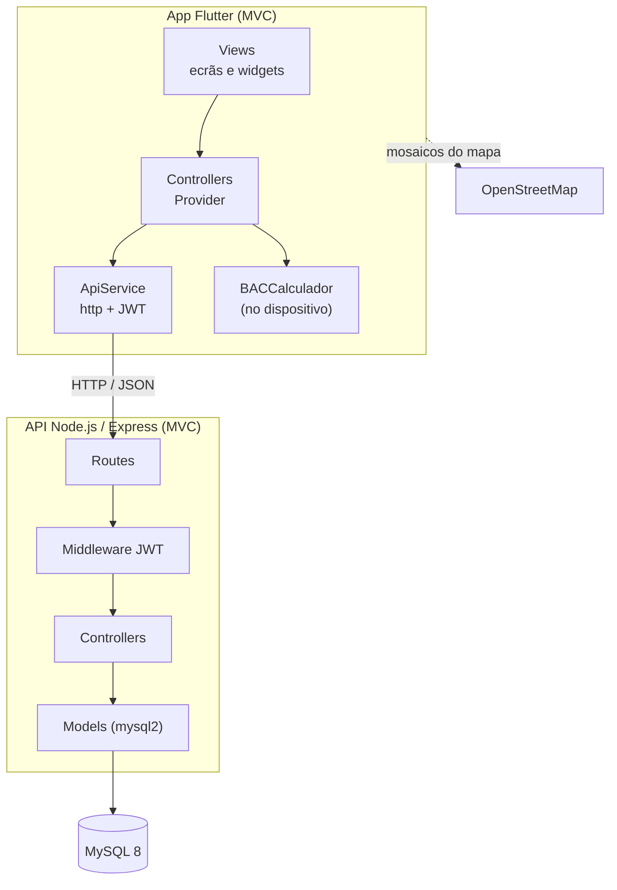
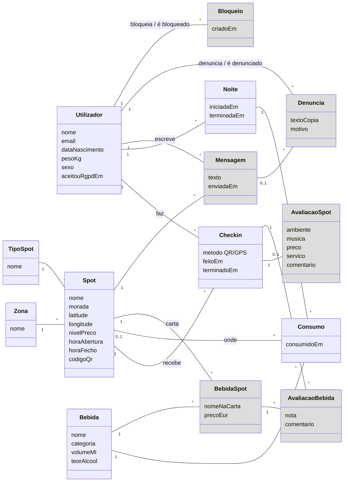
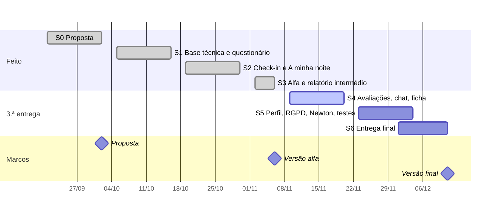
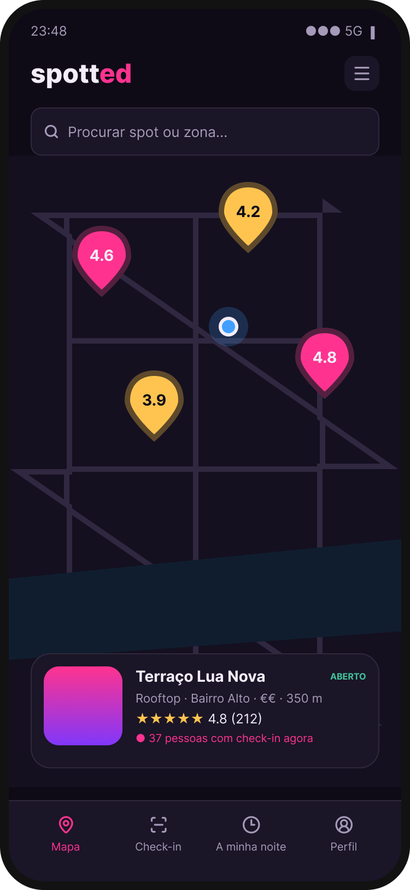
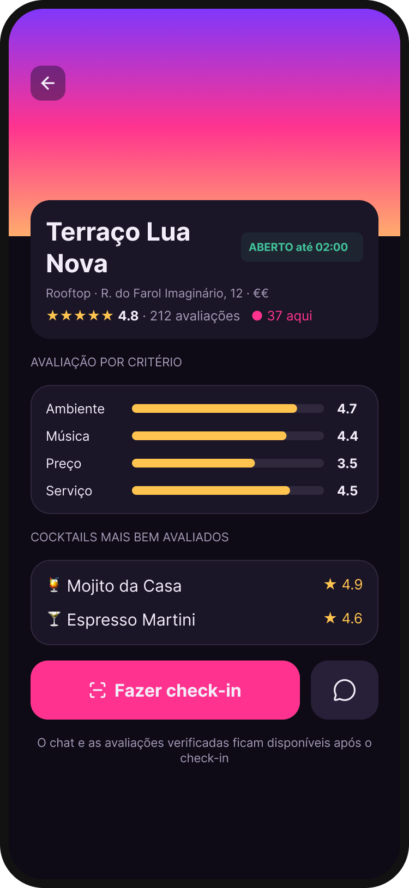
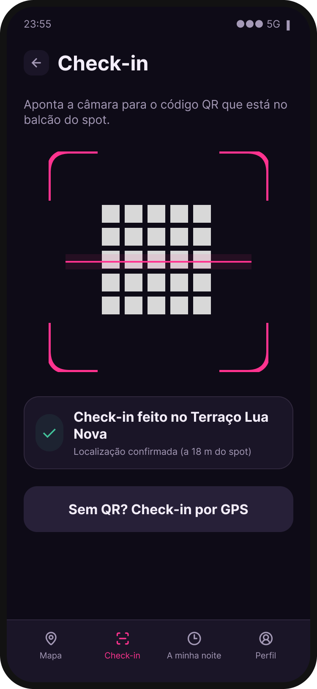
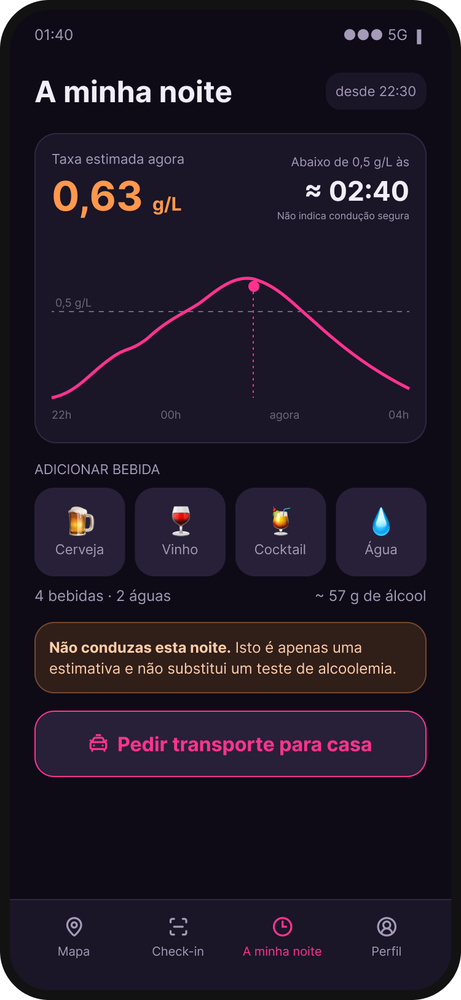

# Spotted

**Descobre o spot, junta-te à noite, volta bem a casa.**

Relatório Intermédio — versão alfa (2.ª entrega)

| | |
|---|---|
| **Universidade** | Universidade Europeia |
| **Faculdade** | IADE — Faculdade de Design, Tecnologia e Comunicação |
| **Curso** | Licenciatura em Engenharia Informática — 2.º ano, 3.º semestre |
| **Ano letivo** | 2026/2027 |
| **Projeto** | Projeto Multidisciplinar Mobile |
| **Grupo** | g09 |
| **Elementos** | José Caeiro — n.º 20231048 Ivanildo Durão — n.º 20252389 Martim Perfeito — n.º 20251863 |
| **Repositório GitHub** | https://github.com/zfresquinho/spotted |
| **Data** | novembro de 2026 |

## 1. Palavras-chave

Vida noturna · Geolocalização · Check-in por QR Code · Consumo responsável · Estimativa de alcoolemia · Flutter · Node.js · MySQL

## 2. A app e o problema

**Spotted** é uma app de vida noturna para Lisboa: mapa de *spots*, **check-in** por QR ou GPS e um **contador de bebidas** que estima a taxa de álcool e avisa quando não se deve conduzir. Avaliações verificadas e chat por spot chegam na versão final.

**Problema:** hoje não há uma app que responda a *onde ir?*, *como está o sítio agora?* e *posso conduzir para casa?*. O Google Maps tem avaliações sem prova de visita, as apps de eventos não mostram o momento e as de consumo não se usam a meio da noite.

## 3. Objetivos e motivação

A noite obriga a usar GPS, câmara e mapas em condições difíceis, e a estimativa de alcoolemia dá ao projeto um fim social. Objetivos:

1. App Flutter com mapa, check-in verificado (QR/GPS) e avaliações.
2. Estimativa de alcoolemia com métodos numéricos (Matemática Discreta).
3. Chat por spot, só para quem fez check-in.
4. API REST Node.js sobre MySQL, documentada, com dados fictícios.
5. Testes de usabilidade com utilizadores reais.
6. RGPD desde a conceção (consentimento, ≥ 18 anos, eliminação de conta).

## 4. Público-alvo e personas

**Primário:** 18–30 anos que saem em Lisboa 2+ vezes por mês. **Secundário:** turistas e Erasmus. **Terciário:** quem quer controlar o consumo sem uma app "de saúde".

### 4.1 Questionário

10 respostas anónimas (Google Forms, 3–4/10/2026). Guião, dados e análise em `Spotted/06_Dados_Investigacao/`.

| Indicador | Resultado |
|---|---|
| Idade 18–25 | **8/10** (2 com 31+; nenhuma entre 26–30) |
| Saem 4+ vezes por mês | **5/10** |
| Vão sempre aos mesmos sítios / por amigos / por redes sociais ou Google Maps | **7 / 3 / 0** |
| Já tiveram dúvidas sobre se podiam conduzir | **8/10** |
| Estimativa de álcool "útil" ou "muito útil" | **10/10** (8 "muito útil") |
| Voltam de carro próprio / TVDE ou táxi | **5 / 5** |

Dos 7 que "sabem sempre" quanto beberam, 5 já duvidaram se podiam conduzir; dos 5 que conduzem, 4 também. **Limitações:** amostra pequena e de conveniência, sem entrevistas.

### 4.2 Personas finais

| Persona | Perfil | Precisa de | Evidência |
|---|---|---|---|
| **Ricardo, 32** (principal) | Engenheiro, sai 4+ vezes por mês, vai de carro | Registar uma bebida num toque e saber a que horas fica abaixo de 0,5 g/L | 4 dos 5 que conduzem já tiveram dúvidas; os 2 inquiridos com 31+ conduzem e saem 4+ vezes por mês |
| **Inês, 22** | Estudante, vai aos sítios de sempre ou dos amigos, volta de TVDE | Saber se o sítio está cheio antes de sair | 7/10 vão aos mesmos sítios; "vazio" é a desilusão mais citada; ninguém escolhe pelas redes sociais (0/10) |
| **Lukas, 24** (secundária) | Erasmus, não conhece ninguém na cidade | Avaliações de quem lá esteve | 2/10 queixam-se de avaliações pouco fiáveis. Parcialmente validada: não houve Erasmus na amostra |

"Combinar com o grupo" foi a queixa mais comum (4/10) e fica como trabalho futuro.

## 5. Pesquisa de mercado

| App | Faz bem | Falta face à Spotted |
|---|---|---|
| **Google Maps** | Cobertura, avaliações, horários | Avaliações sem prova de visita; sem estado em tempo real |
| **XCEED** | Bilhetes e eventos em Lisboa | Sem avaliação de bares nem segurança |
| **Untappd** | Check-in e avaliação de bebidas | Centrada na bebida, não no spot |
| **MyDrinkaware** | Registo de unidades e metas | Sem componente social nem uso noturno |
| **DrinkControl** | Registo rápido de bebidas | Não estima a taxa ao longo da noite |

Nenhuma junta o **local**, o **momento** e a **pessoa**.

## 6. Guiões de teste finais

Correspondem ao que a versão alfa faz. Dados fictícios.

**CU1 (core) — Encontrar um spot e fazer check-in.** *Pré-condições:* sessão iniciada, localização autorizada, QR no balcão.

1. No **mapa**, pesquisa *"Lua"* ou filtra **Rooftop** → fica só o *Terraço Lua Nova*.
2. No local, abre o separador **Check-In** e lê o **QR** do balcão.
3. A app confirma o check-in (ativo 4 h).

*Alternativa:* **check-in por GPS**, escolhendo o spot na lista; só é aceite a < 100 m e com precisão ≤ 100 m. *Esperado:* check-in em < 1 min sem ajuda; fora do raio, recusa com mensagem clara.

**CU2 — Registar a noite e ver a estimativa.** *Pré-condições:* utilizador com peso e sexo na BD (ainda sem ecrã de perfil).

1. Abre **Minha Noite** e toca em **Cocktail** (a noite é criada no primeiro registo). Repete; regista **Água**.
2. Vê a taxa atual, o gráfico e a hora abaixo de 0,5 g/L; acima do limite aparece o aviso para não conduzir.

*Esperado:* 1 toque por bebida (limite: 3); aviso sempre que ≥ 0,5 g/L.

**CU3 — Criar conta e entrar.**

1. Preenche nome, email, data de nascimento, palavra-passe (×2) e aceita os termos.
2. Menor de 18, palavras-passe diferentes ou termos por aceitar → erro e conta não criada.
3. Conta criada → a app muda para o login; entra e chega ao mapa.

*Esperado:* em < 2 min; menores não conseguem registar-se.

## 7. Descrição da solução

Quatro módulos: **Descobrir**, **Check-in**, **A minha noite** e **Perfil**. A alfa cobre os três primeiros.

### 7.1 Enquadramento nas UCs

| UC | Contributo |
|---|---|
| Projeto de Desenvolvimento Móvel | Sprints e Kanban no GitHub Projects, relatórios, arquivo |
| Programação de Dispositivos Móveis | App Flutter, API Node.js, MVC, documentação REST |
| Bases de Dados | MySQL com 14 tabelas, `populate.sql`, `queries.sql` |
| Redes e Comunicação de Dados | HTTP/JSON, JWT, Socket.io no chat |
| Interfaces e Usabilidade | Questionário, personas, mockups, UI noturna, testes |
| Matemática Discreta | Widmark, Haversine; Newton/bisseção na 3.ª entrega |

### 7.2 Requisitos

| ID | Requisito | Prior. | Estado |
|---|---|---|---|
| RF01–02 | Registo (≥ 18, RGPD) e login | Must | Feito |
| RF03 | Mapa com spots e posição | Must | Feito |
| RF04 | Filtros por tipo, preço, zona e classificação | Must | Parcial: tipo, preço e pesquisa |
| RF05 | Ficha do spot | Must | Parcial: só endpoint |
| RF06–07 | Check-in por QR e por GPS (100 m) | Must | Feito |
| RF08 | Avaliar spot após check-in | Must | 3.ª entrega |
| RF09 | Registar bebidas a partir do catálogo | Must | Parcial: sem escolha na categoria |
| RF10 | Estimativa e hora abaixo de 0,5 g/L | Must | Feito (fórmula fechada) |
| RF11 | Aviso "Não conduzas" e atalho para transporte | Must | Parcial: só aviso |
| RF12–15 | Chat, denúncias, avaliação de cocktails | Should | 3.ª entrega |
| RF16–17 | Histórico; eliminar conta (RGPD) | Could/Must | 3.ª entrega |

**Não funcionais:** modo escuro, alvos ≥ 48 dp, bcrypt, JWT, MVC, dados fictícios. Na alfa a API usa HTTP na rede local; a final passa a HTTPS.

### 7.3 Arquitetura

A estimativa é calculada **no dispositivo** (`BACCalculador`); a validação do check-in (Haversine, janela de 4 h) é feita **no servidor**, para não poder ser contornada.

### 7.4 Diagrama de classes (esboço)

Diagrama conceptual das entidades e relações. A cinzento ficam as que só entram na 3.ª entrega (avaliações, chat, denúncias, bloqueios).

As avaliações ligam-se ao **check-in** e não ao utilizador: assim só avalia quem esteve no spot (1 avaliação por check-in).

### 7.5 Tecnologias

| Camada | Tecnologias usadas na alfa |
|---|---|
| App | Flutter 3 / Dart, `provider`, `http`, `shared_preferences`, `flutter_map` + OpenStreetMap, `geolocator`, `mobile_scanner`, `fl_chart` |
| Servidor | Node.js, Express 5, `mysql2`, `jsonwebtoken`, `bcrypt`, `dotenv`, `cors` (`socket.io` instalado para o chat) |
| Base de dados | MySQL 8, MySQL Workbench |
| Design e gestão | Figma, GitHub, GitHub Projects, Postman |

### 7.6 Documentação REST

A API tem **12 endpoints** com prefixo `/api`. Documentação completa (formato Bocoup) em [`Documentos/api.md`](https://github.com/zfresquinho/spotted/blob/main/Documentos/api.md). A coluna "Sessão" indica os que exigem token JWT.

| Método | URL | Descrição | Sessão |
|---|---|---|---|
| GET | `/api/health` | Estado da API e da BD | |
| POST | `/api/auth/registar` | Criar conta | |
| POST | `/api/auth/login` | Iniciar sessão (devolve JWT) | |
| GET | `/api/spots` | Listar spots | |
| GET | `/api/spots/:id` | Obter um spot | |
| GET | `/api/bebidas` | Catálogo de bebidas | |
| POST | `/api/checkins/gps` | Check-in por GPS | Sim |
| POST | `/api/checkins/qr` | Check-in por código QR | Sim |
| GET | `/api/checkins/ativos` | Check-ins ativos do utilizador | Sim |
| POST | `/api/checkins/:id/checkout` | Terminar um check-in | Sim |
| GET | `/api/noites/atual` | Noite ativa com consumos | Sim |
| POST | `/api/noites/atual/consumos` | Registar uma bebida na noite ativa | Sim |

### 7.7 Base de dados

O Dicionário de Dados, o Guia de Dados e o BD Report são entregues mais tarde, com autorização do docente de Bases de Dados.

## 8. Planeamento

### 8.1 Plano de trabalhos

| Sprint | Feito | Passa para a 3.ª entrega |
|---|---|---|
| S1 (05–16/10) | `create.sql`, API de auth e spots, registo, login, mapa; questionário | Export do Figma de alta fidelidade |
| S2 (19–30/10) | Check-in QR/GPS, "A minha noite", `populate.sql`, `queries.sql` | **Avaliação de spots** (só a tabela existe) |
| S3 (02–06/11) | Integração app–API, doc REST, problemas conhecidos, este relatório | Dicionário de Dados, Guia de Dados, BD Report (autorizado) |
| **S4** (09–20/11) | — | Avaliações, chat Socket.io com denúncias, ficha do spot, terminar noite, bugs prioritários |
| **S5** (23/11–04/12) | — | Perfil e RGPD, Newton/bisseção, documentação da BD, testes de usabilidade |
| **S6** (01–11/12) | — | Poster, vídeo, slides, manual, relatório final |

### 8.2 Gráfico de Gantt

## 9. Estado da versão alfa

**Funciona** (Flutter + Node/Express + MySQL, MVC nos dois lados):

- Registo (≥ 18, RGPD, confirmação de palavra-passe, bcrypt) e login com JWT.
- Mapa (`flutter_map` + OpenStreetMap) com pesquisa por nome ou zona e filtros por tipo e preço.
- Check-in por QR (UUID por spot) e GPS (Haversine, raio e precisão de 100 m), ativo 4 h, vários em simultâneo; checkout na API.
- "A minha noite": catálogo, consumos, estimativa de Widmark, gráfico (`fl_chart`), hora abaixo de 0,5 g/L e aviso para não conduzir.
- Documentação REST de todos os endpoints.

**Não funciona ainda:**

- **Avaliações** de spots e cocktails (previstas para S2): demos prioridade ao check-in e à estimativa, as funções mais valorizadas no questionário.
- **Chat** e denúncias; **ficha do spot**, botão de checkout e atalho para transporte na app.
- **Perfil** (peso/sexo, histórico), terminar a noite e eliminar conta.
- **Newton/bisseção:** a hora abaixo de 0,5 g/L usa ainda fórmula fechada (absorção imediata).

**Limitações principais** (lista em `Documentos/problemas-conhecidos.md`): não se escolhe a bebida dentro da categoria (N5), não há confirmação após o toque (N2), não se apaga um consumo (N3), a hora não mostra o dia (N1) e a noite nunca termina (N7).

## 10. Conclusão e próximos passos

A alfa cumpre o núcleo: **criar conta, encontrar um spot, fazer check-in e acompanhar a noite**. O questionário reforçou a estimativa de alcoolemia (10/10 acham útil) e definiu o Ricardo como persona principal. Atrasaram-se as avaliações.

**Até 11/12:** avaliações com média bayesiana; chat com denúncias; perfil e eliminação de conta; Newton/bisseção validados à mão; correção de N1–N3, N5 e N7; testes de usabilidade com os 3 guiões (incluindo um Erasmus); documentação da BD.

## 11. Bibliografia

- Universidade Europeia / IADE (2026). *Projeto Mobile — Project Briefing (L-EI), 2026-2027, 3.º semestre.*
- Grupo g09 (2026). *Questionário "Saídas à noite em Lisboa": guião, respostas e análise.* `Spotted/06_Dados_Investigacao/`.
- Widmark, E. M. P. (1932). *Die theoretischen Grundlagen und die praktische Verwendbarkeit der gerichtlich-medizinischen Alkoholbestimmung.* Berlin: Urban & Schwarzenberg.
- Burden, R. L., Faires, J. D. & Burden, A. M. (2016). *Numerical Analysis* (10.ª ed.). Cengage Learning.
- Sinnott, R. W. (1984). Virtues of the Haversine. *Sky and Telescope*, 68(2), 159.
- Miller, E. (2012). *Bayesian Average Ratings.* https://www.evanmiller.org/bayesian-average-ratings.html
- Nielsen, J. (1994). *10 Usability Heuristics for User Interface Design.* Nielsen Norman Group.
- Regulamento (UE) 2016/679 — Regulamento Geral sobre a Proteção de Dados (RGPD).
- Código da Estrada, art. 81.º — Condução sob influência de álcool.
- Decreto-Lei n.º 50/2013 — Regime de disponibilização e venda de bebidas alcoólicas.
- Bocoup (2013). *Documenting Your API.* https://bocoup.com/blog/documenting-your-api
- Flutter. https://docs.flutter.dev · flutter_map. https://docs.fleaflet.dev · OpenStreetMap. https://www.openstreetmap.org/copyright · Express. https://expressjs.com · MySQL 8.0 Reference Manual. https://dev.mysql.com/doc · Socket.IO. https://socket.io/docs
- XCEED. https://xceed.me/en/lisboa/events · Untappd. https://untappd.com · MyDrinkaware. https://www.drinkaware.co.uk/tools/mydrinkaware-app · DrinkControl. https://apps.apple.com/app/id456207840

## Anexo A — Mockups

Mockups de média fidelidade. O chat, a avaliação, a ficha completa do spot e o perfil ainda não estão implementados na versão alfa.

