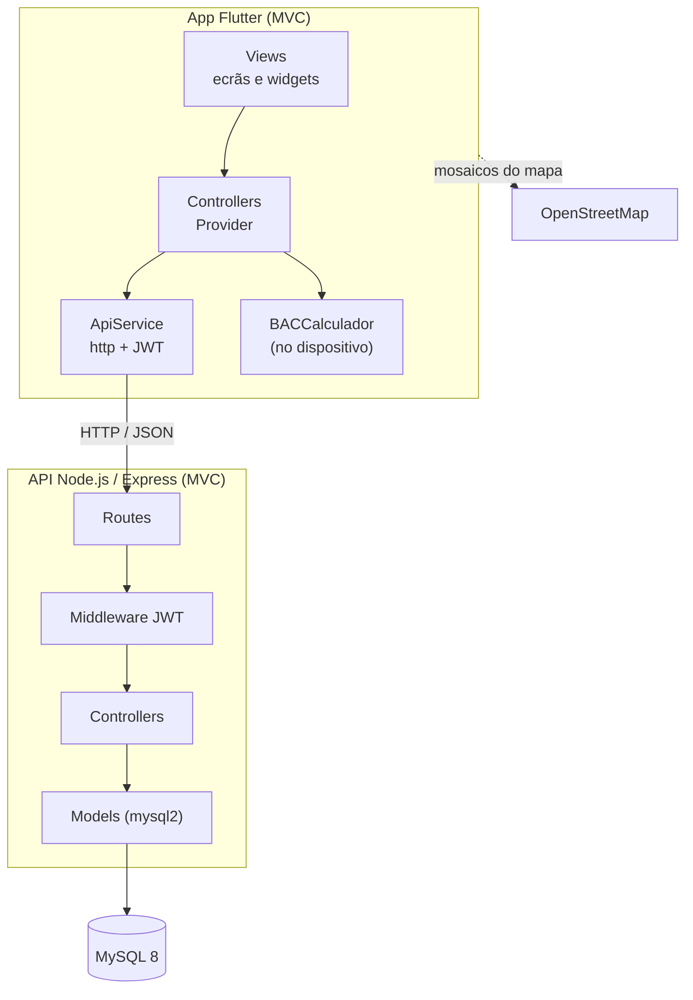
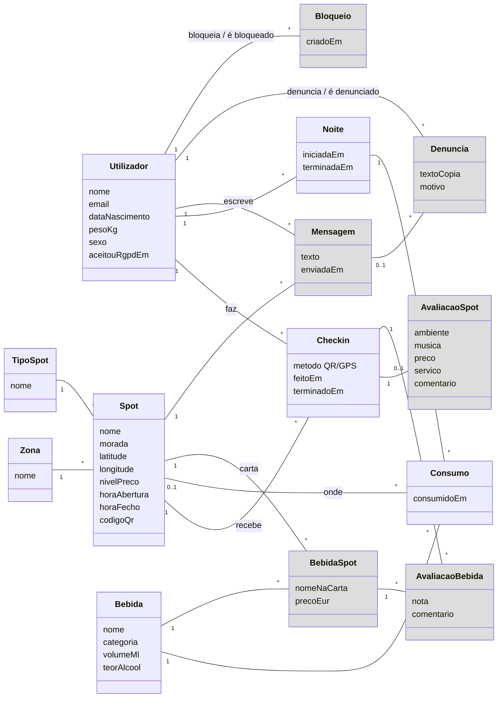

# Documentação técnica — Spotted

Ficheiros técnicos do projeto (ponto 9.2.1.4 do briefing). Atualizado a 8 de novembro de 2026 (versão alfa, 2.ª entrega).

| Item | Onde |
|---|---|
| a. Arquitetura do sistema | [abaixo](#a-arquitetura-do-sistema) |
| b. Diagramas UML | [diagrama de classes](#b-diagrama-de-classes-esboço) |
| c. Estrutura da base de dados | [`database/create.sql`](../../database/create.sql) · [`populate.sql`](../../database/populate.sql) · [`queries.sql`](../../database/queries.sql) |
| d. Capturas da aplicação | [`02_Imagens/`](../02_Imagens/) |
| e. Repositório Git | https://github.com/zfresquinho/spotted |
| Documentação REST | [`Documentos/api.md`](../../Documentos/api.md) (formato Bocoup) |
| Relatório intermédio | [`Documentos/g09-relatorio-intermedio.md`](../../Documentos/g09-relatorio-intermedio.md) |

## a. Arquitetura do sistema

App Flutter e API REST em Node.js/Express, ambas em MVC, com base de dados MySQL. A app comunica com a API por HTTP/JSON e autentica-se com um token JWT.

- A estimativa de alcoolemia é calculada **no dispositivo** (`BACCalculador`, modelo de Widmark).
- A validação do check-in (distância por Haversine, raio de 100 m, janela de 4 h) é feita **no servidor**, para não poder ser contornada.

| Camada | Pastas no repositório |
|---|---|
| App (Views, Controllers, Models, Services) | `app/lib/views`, `app/lib/controllers`, `app/lib/models`, `app/lib/services`, `app/lib/utils` |
| API (Routes, Middleware, Controllers, Models) | `server/src/routes`, `server/src/middleware`, `server/src/controllers`, `server/src/models` |
| Base de dados | `database/` |

## b. Diagrama de classes (esboço)

Diagrama conceptual das entidades e relações, tirado do `create.sql`. A cinzento ficam as que só entram na 3.ª entrega (avaliações, chat, denúncias, bloqueios).

As avaliações ligam-se ao **check-in** e não ao utilizador: assim só avalia quem esteve no spot (1 avaliação por check-in).

## c. Estrutura da base de dados

MySQL 8 com 14 tabelas: `utilizador`, `zona`, `tipo_spot`, `spot`, `checkin`, `avaliacao_spot`, `bebida`, `bebida_spot`, `avaliacao_bebida`, `noite`, `consumo`, `mensagem`, `denuncia`, `bloqueio`. O Dicionário de Dados, o Guia de Dados e o BD Report são entregues mais tarde, com autorização do docente de Bases de Dados.
